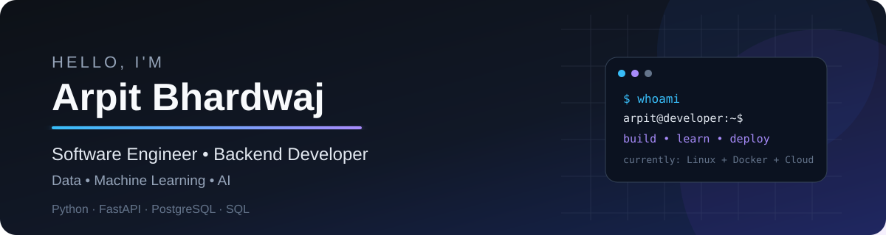
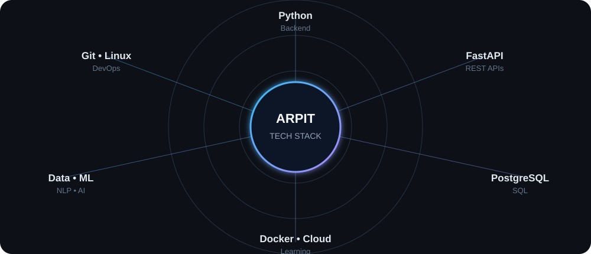
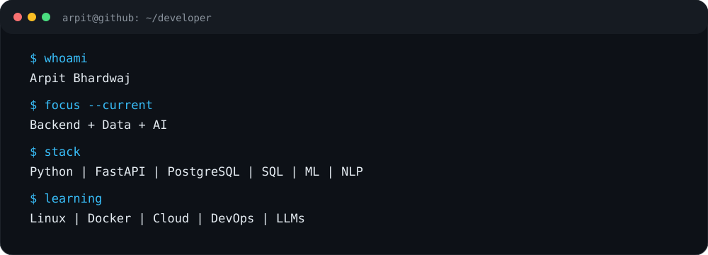

<div align="center">



# 👋 Hi, I'm Arpit Bhardwaj

### Aspiring Software Engineer | Backend Developer | Data & AI Enthusiast

**B.Tech Computer Science & Engineering | 2027**

I build practical applications using **Python, FastAPI, PostgreSQL, SQL, Data Analytics and Machine Learning**.

Currently strengthening my software engineering foundation with **Linux, Git, Docker, Networking, CI/CD and Cloud fundamentals** while exploring **AI/LLM applications**.

<br/>

<a href="https://github.com/ArpitBhardwaj997">

</a>
<a href="https://linkedin.com/in/arpitbhardwaj614">

</a>

</div>

---

## 👨‍💻 About Me

- 🎓 B.Tech CSE student graduating in **2027**
- 💻 Building backend applications with **Python, FastAPI & PostgreSQL**
- 🔌 Developing **REST APIs, authentication and database-driven applications**
- 📊 Interested in **Data Analytics, Data Science & Machine Learning**
- 🤖 Building projects with **NLP and Machine Learning**
- 🏫 Built and delivered a **paid freelance School Management System**
- 🧪 Exploring **Playwright & TypeScript test automation**
- 🧠 Practicing **DSA, SQL, OOP and problem solving**
- 🐧 Strengthening **Linux and Git** fundamentals
- 🐳 Learning **Docker and containerization**
- 🌐 Building knowledge of **computer networking fundamentals**
- 🔄 Learning **CI/CD and DevOps fundamentals**
- ☁️ Exploring **Cloud fundamentals and application deployment**
- 🤖 Exploring **LLM and AI application development**

---

# 🛠️ Technical Skills

## 💻 Programming


`Python` `JavaScript` `TypeScript` `SQL`

---

## ⚙️ Backend & APIs


`FastAPI` `Flask` `REST APIs` `JWT Authentication`  
`SQLAlchemy` `Pydantic`

---

## 🗄️ Databases


`PostgreSQL` `MySQL`

**SQL**

`Joins` `Aggregations` `Subqueries` `CTEs`  
`Window Functions` `Data Cleaning` `Data Analysis`

---

## 📊 Data & Analytics

`Pandas` `NumPy` `Excel` `Power BI`

`EDA` `Data Cleaning` `Data Wrangling`  
`Data Visualization` `Statistical Analysis` `SQL Analytics`

---

## 🤖 Machine Learning & NLP

`Scikit-learn` `Machine Learning` `NLP`

`Regression` `Classification` `Feature Engineering`  
`Model Evaluation` `Text Classification`  
`Bag of Words` `TF-IDF`

---

## 🧪 Testing


`Playwright` `TypeScript Test Automation`  
`Functional Testing` `UI Testing` `Test Automation`

---

## 🐧 Linux, Docker & DevOps


**Linux**

`Linux CLI` `File System` `Permissions` `Processes`  
`Environment Variables` `Package Management` `Shell Basics`

**Docker**

`Containers` `Images` `Dockerfiles` `Ports`  
`Volumes` `Environment Variables` `Containerized Applications`

**DevOps / CI/CD**

`Git Workflows` `CI/CD Fundamentals` `Build & Deployment Concepts`  
`Automation Fundamentals` `Application Deployment`

---

## 🌐 Networking Fundamentals

`HTTP / HTTPS` `TCP/IP` `DNS` `IP Addresses`  
`Ports` `Client-Server Architecture` `REST`  
`Request / Response` `Basic Network Troubleshooting`

---

## ☁️ Cloud & Development Tools

`Cloud Fundamentals` `Deployment Concepts`


`Git` `GitHub` `VS Code` `Render` `Neon PostgreSQL`

---

# 🚀 Featured Projects

## 🏫 School Management System

**Paid Freelance Project**

A web-based school management system built for managing student records and fee operations through an admin-controlled workflow.

### Tech Stack

`HTML` `CSS` `JavaScript` `FastAPI` `PostgreSQL`  
`SQLAlchemy` `JWT`

### Key Features

- 🔐 Admin authentication
- 👨‍🎓 Student management
- 🏫 Class management
- 💰 Fee structure management
- 💳 Payment tracking
- ⚠️ Due fee tracking
- 🗄️ PostgreSQL database integration
- 🔌 REST API backend

🔗 **[View Repository](https://github.com/ArpitBhardwaj997/school-management)**

---

## ❤️ Heart Disease Prediction

End-to-end machine learning project covering **data preprocessing, exploratory data analysis, model training, evaluation and Streamlit deployment**.

### Models

`Logistic Regression` `KNN` `Naive Bayes`  
`Decision Tree` `SVM`

### Best Result

**85.87% Accuracy — Logistic Regression**

🔗 **[View Repository](https://github.com/ArpitBhardwaj997/Heart-Disease-Prediction-using-Machine-Learning)**

---

## 😊 Emotion Detection NLP

NLP-based emotion classification project using machine learning and text vectorization.

### Tech Stack

`Python` `NLP` `Scikit-learn` `Flask`

### Best Result

**88.53% Accuracy — Bag of Words + Logistic Regression**

🔗 **[View Repository](https://github.com/ArpitBhardwaj997/Emotion-Detection-NLP)**

---

# 🧭 Current Learning Path



### 🐧 Linux & Git

- Linux command line
- File system and permissions
- Processes and environment variables
- Git branching and workflows
- GitHub repositories and collaboration

### 🐳 Docker

- Container fundamentals
- Images and Dockerfiles
- Port mapping
- Volumes
- Environment variables
- Running applications in containers

### 🌐 Networking

- HTTP / HTTPS
- TCP/IP fundamentals
- DNS
- IP addresses
- Ports
- Client-server architecture
- Request / response flow

### 🔄 CI/CD & DevOps

- CI/CD fundamentals
- Automated build concepts
- Testing and deployment workflows
- Git-based workflows
- DevOps fundamentals
- Application deployment

### ☁️ Cloud

- Cloud computing fundamentals
- Compute, storage and networking concepts
- Application deployment
- Cloud service fundamentals

### 🤖 AI & LLM

- LLM fundamentals
- Prompt Engineering
- AI application development
- LLM APIs
- RAG fundamentals
- AI automation

---

# 🖥️ Development Focus



```text
Python
   ↓
Backend Development
   ↓
FastAPI + PostgreSQL
   ↓
Git + Linux
   ↓
Networking Fundamentals
   ↓
Docker
   ↓
CI/CD
   ↓
Cloud & DevOps
   ↓
AI / LLM Applications
```

> Building real projects, strengthening fundamentals, and continuously improving.

---

# 📈 GitHub Stats

<div align="center">


<br/><br/>


</div>

---

# 🐍 Contribution Activity

<div align="center">


</div>

---

# 📊 What I Like Building

```text
Backend Engineering
    │
    ├── FastAPI
    ├── PostgreSQL
    ├── Authentication
    └── REST APIs

Data & Analytics
    │
    ├── Python
    ├── SQL
    ├── Power BI
    └── Data Analysis

Machine Learning
    │
    ├── Classification
    ├── NLP
    ├── Feature Engineering
    └── Model Evaluation

Infrastructure & DevOps
    │
    ├── Linux
    ├── Networking
    ├── Docker
    ├── CI/CD
    └── Cloud

Future Focus
    │
    └── AI / LLM Applications
```

---

# 🤝 Let's Connect

I'm interested in opportunities related to:

**Software Engineering • Backend Development • Data Analytics • Data Science • Machine Learning • AI/ML • Cloud & DevOps**

<div align="center">

<a href="https://linkedin.com/in/arpitbhardwaj614">

</a>

<a href="https://github.com/ArpitBhardwaj997">

</a>

</div>

<br/>

<div align="center">

### 🚀 Building. Learning. Improving.

**Thanks for visiting my profile!**

</div>